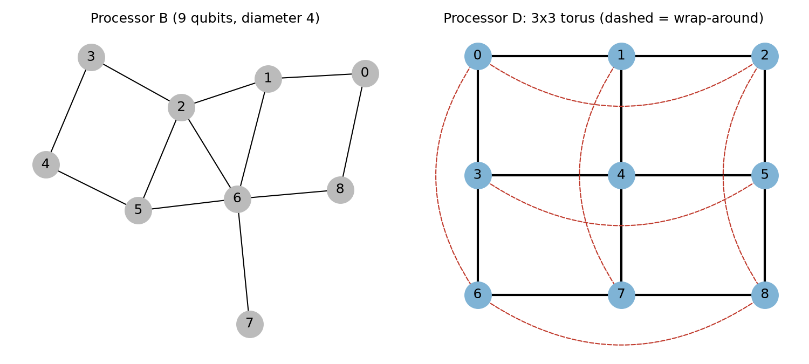
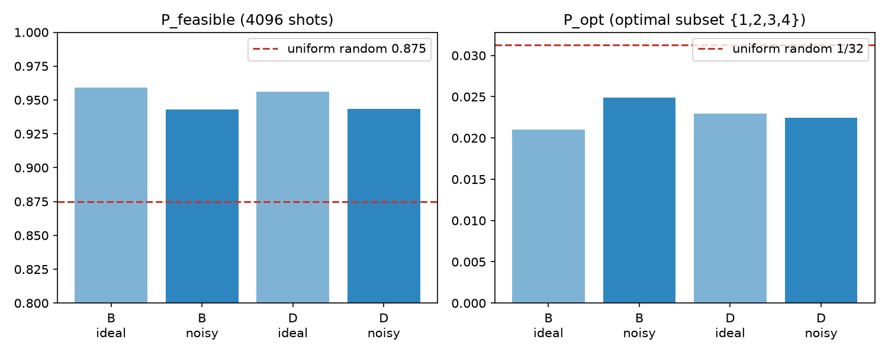
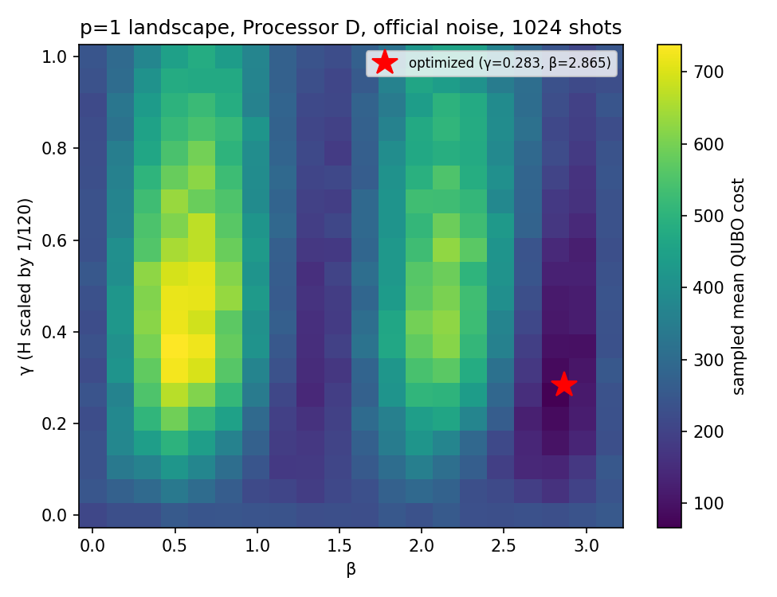
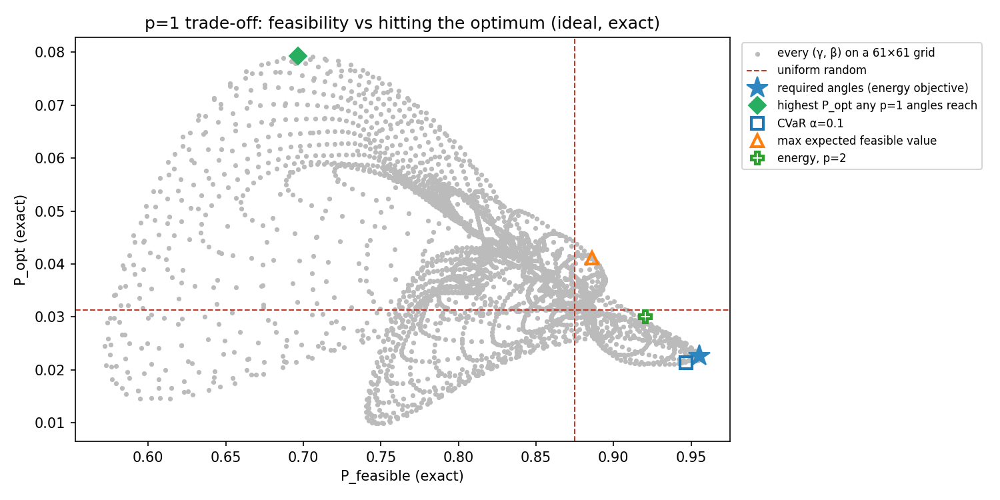

# PS-O3 — Resource-Constrained Item Selection with QAOA
Qiskit Fall Fest 2026, Phase 2, Optimization Track · Team KanyaRaasi

All numbers below are produced by `main.ipynb` with the official settings (basis rz/sx/x/cx, optimization_level 1, SABRE, seeds 42, 4096 shots, official noise model).

## 1. Problem and formulation

Five items with values v = [10, 4, 7, 5, 8] and weights w = [5, 3, 4, 2, 6] must be packed into capacity W = 15 to maximize total value. Item n of the problem statement is qubit n − 1.

The constraint Σ wᵢxᵢ ≤ 15 is turned into an equality with a binary slack s = s₀ + 2s₁ + 4s₂ + 8s₃ on qubits 5–8, and enforced with the locked penalty P = 5:

min −Σ vᵢxᵢ + P(Σ wᵢxᵢ + s − 15)²

Writing all nine bits as z with coefficients a = [5, 3, 4, 2, 6, 1, 2, 4, 8] and using zᵢ² = zᵢ gives the QUBO zᵀQz + 1125 with Qᵢᵢ = P(aᵢ² − 30aᵢ) − vᵢ and Qᵢⱼ = 2P·aᵢaⱼ (i < j). The full 9×9 matrix is printed in the notebook and saved in `results/tables/qubo_9x9.json`.

Because every aᵢ > 0, **every pair of variables is coupled**: the cost graph is the complete graph K₉ with 36 edges. This is the fact that drives the whole hardware discussion.

**Classical benchmark.** Exhaustive search over the 32 item subsets gives V\* = 26 with items {1, 2, 3, 4} (weight 14), the unique optimum. 28 of 32 subsets are feasible. Brute force over all 512 QUBO bitstrings gives the minimum −26 at the same items with slack s = 1, so the QUBO's ground state is the true optimum at P = 5.

**Checking the encoding, not just its minimum.** The notebook also evaluates the kit's formula directly on all 512 bitstrings and compares it with the saved 9 × 9 matrix: 0 mismatches. Then, for each of the 32 item subsets, it takes the lowest energy over the 16 slack values:
- **All 28 feasible bags** get exactly −(value): the slack can always absorb the unused capacity, so the penalty is zero and the encoding is exact.
- **All 4 overweight bags** score worse than the optimum, so P = 5 is large enough:

| Overweight items | Value | Weight | Lowest energy | vs optimum (−26) |
|---|---|---|---|---|
| {1, 3, 4, 5} | 30 | 17 | −10 | worse by 16 |
| {1, 2, 4, 5} | 27 | 16 | −22 | worse by 4 |
| {1, 2, 3, 5} | 29 | 18 | +16 | worse by 42 |
| {1, 2, 3, 4, 5} | 34 | 20 | +91 | worse by 117 |

The tightest case is {1, 2, 4, 5}: one unit over capacity costs P·1² = 5, which outweighs its extra value of 1 over the optimum. That is why P = 1 fails (Section 6) and any P ≥ 2 works.

**Random baseline.** Sampling item bits uniformly gives P_feasible = 0.875 and P_opt = 1/32 = 0.031. Because most subsets fit, P_feasible is a demanding baseline, and we compare against it explicitly.

**Cost Hamiltonian.** With zᵢ = (1 − Zᵢ)/2 the QUBO becomes 9 Z terms + 36 ZZ terms + a constant (46 Pauli terms). Its diagonal matches the QUBO on all 512 bitstrings. The largest non-identity coefficient is 120, so we use H/120 inside QAOA, as the kit recommends; all γ values below are in units of this scaled Hamiltonian.

## 2. Bell-state verification (Objective 1)

|Φ⁺⟩ was prepared with H(0) and CX(0→1) and measured in the ZZ, XX and YY bases (4096 shots each) on Processor D. The farthest pair on the torus is at distance 2; we used (0, 4).

| Pair | Distance | Condition | CX | ⟨XX⟩ | ⟨YY⟩ | ⟨ZZ⟩ | F |
|---|---|---|---|---|---|---|---|
| 0–1 | 1 | ideal | 1 | +1.000 ± 0.000 | −1.000 ± 0.000 | +1.000 ± 0.000 | 1.0000 ± 0.0000 |
| 0–1 | 1 | noisy | 1 | +0.946 ± 0.005 | −0.952 ± 0.005 | +0.955 ± 0.005 | 0.9633 ± 0.0021 |
| 0–4 | 2 | ideal | 4 | +1.000 ± 0.000 | −1.000 ± 0.000 | +1.000 ± 0.000 | 1.0000 ± 0.0000 |
| 0–4 | 2 | noisy | 4 | +0.945 ± 0.005 | −0.936 ± 0.005 | +0.939 ± 0.005 | 0.9548 ± 0.0023 |

The ideal runs reach the exact values (XX = +1, YY = −1, ZZ = +1), confirming the circuits and bases. With noise, the adjacent pair loses about 3.7% fidelity. Most of that comes from readout: a 1% bit flip on each of two qubits turns about 2% of shots from even to odd parity, which lowers each correlator by about 0.04. The rest comes from depolarizing on the CX and the single-qubit gates. The distant pair needs a SWAP, so the transpiled circuit has 4 CX instead of 1, and its measured fidelity is 0.0085 lower. Distance on the coupling graph turns directly into extra CX and extra error. That is why D was designed to keep every pair within distance 2.

**Checking the noisy numbers** (`results/tables/bell_noise_check.csv`). We ran the same transpiled circuits with 2,000,000 shots to get the expected fidelity with negligible sampling error (about 0.0003), and repeated the 4096-shot experiment with 40 different simulator seeds:

| Pair | CX | Reported F (kit SE) | Expected F (2M shots) | 40 seeds: mean ± std |
|---|---|---|---|---|
| 0–1 | 1 | 0.9633 ± 0.0021 | 0.9631 | 0.9629 ± 0.0030 |
| 0–4 | 4 | 0.9548 ± 0.0023 | 0.9561 | 0.9556 ± 0.0036 |

Both reported values match the expected fidelities, so the noisy results are correct. Two refinements:
- **The real uncertainty is about 1.5× the kit's SE.** The SE formula assumes the three bases are sampled independently, but `bell_experiment` measures all three with the same simulator seed, so their sampling noise is correlated. The 40-seed spread (0.0030 and 0.0036) is the honest error bar.
- **The near/far gap is real but smaller than measured.** The expected cost of the 3 extra CX is 0.0070 in fidelity. The measured gap, 0.0085, is 1.8× the real spread, so a single 4096-shot run alone would not prove it; the 2,000,000-shot reference does.

An independent implementation of the Bell procedure (our own circuits and parity counting) reproduces both reported noisy fidelities exactly, well within the kit's 2-standard-error requirement.

## 3. Processor D design (Objective 2)

**Bottleneck on B.** On Processor B the bound p = 1 circuit needs 72 logical CX but 121 after routing: 17 SWAPs, 49 CX overhead (68% extra), depth 117 and two-qubit depth 79. B has diameter 4 and an uneven degree profile (degrees 1 to 5, one leaf qubit), while our cost graph is K₉, so many of the 36 interactions are between distant qubits.

**Design.** Processor D is a 3×3 torus: the 3×3 grid plus wrap-around edges on each row and column. It has 9 qubits and 18 edges, every qubit has degree exactly 4 (the maximum allowed), and the diameter is 2. It passes `validate_processor_d` (the notebook also prints each rule: 9 qubits, connected, maximum degree 4, gates rz/sx/x/cx, official noise) and uses the official noise rates.

**Frozen.** `processors/processor_D.json` has not changed since commit `78fbcd0`. The notebook loads it once, in Section 3, prints its SHA-256 fingerprint (`02ac9d06…e7cc537b`), and uses that same object for the Bell test, every D benchmark row and the landscape.

**How we chose it** (notebook Section 6, `results/tables/processor_D_search.csv`). We measured the bound p = 1 QAOA circuit with the official `circuit_metrics()` on 153 valid candidates: circulant graphs C_n(j₁, j₂) on 9–12 qubits, random 4-regular graphs on 9 and 10 qubits (seeds 0–59), 3×4, 2×5 and 2×6 tori, and the plain 3×3 grid. **The 3×3 torus ranks first** by CX count. Best of each family:

| Candidate | Qubits | Couplers | Diameter | CX | Depth | SWAPs |
|---|---|---|---|---|---|---|
| **3×3 torus (chosen)** | 9 | 18 | 2 | **89** | **76** | **9** |
| best random 4-regular (9 qubits, seed 58) | 9 | 18 | 2 | 95 | 85 | 9 |
| best circulant, C₁₂(3, 4) | 12 | 24 | 3 | 98 | 89 | 10 |
| best other torus, 3×4 | 12 | 24 | 3 | 108 | 109 | 12 |
| 3×3 grid, no wrap-around | 9 | 12 | 4 | 117 | 110 | 15 |
| Processor B (reference) | 9 | 12 | 4 | 121 | 117 | 17 |

The grid row isolates what the wrap-around edges buy: the same 3×3 layout without them needs 117 CX, so the 6 wrap-around couplers save 28 CX. Extra qubits did not help: the best 12-qubit candidates are worse, because with K₉ every logical qubit must interact with every other, so the router gains more from short distances than from spare qubits.

**Expected effect vs measured.** We expected D to roughly halve the SWAPs and cut CX by about a quarter, which should reduce the noise penalty without changing the ideal result. Measured on the same angles:

| | B | D | Change |
|---|---|---|---|
| CX | 121 | 89 | −26% |
| CX overhead | 49 | 17 | −65% |
| SWAPs | 17 | 9 | −47% |
| Depth | 117 | 76 | −35% |
| Two-qubit depth | 79 | 43 | −46% |
| Mean QUBO cost, ideal | 49.2 | 52.5 | sampling difference only |
| Mean QUBO cost, noisy | 82.8 | 73.7 | −11% |
| Noise penalty (noisy − ideal) | +33.6 | +21.2 | −37% |
| P_feasible, noisy | 0.943 | 0.943 | equal |

The ideal rows prepare the same state on both processors, so their difference is shot noise. The noise-induced rise in mean QUBO cost is 37% smaller on D, consistent with 26% fewer CX and a 46% smaller two-qubit depth. P_feasible is the same on both, because feasibility is a coarse property that survives this level of noise. The gain from D shows up in the energy, not in the feasibility rate.

**Trade-off.** We first checked whether D only suits our all-to-all problem. On p = 1 QAOA circuits for 30 random 9-node cost graphs (edge probability 0.5), D needed fewer routing CX than B on all 30 (mean overhead 9.7 vs 17.0 CX; the 3×3 grid without wrap-around averaged 19.0). So for 9-qubit workloads the price of D is not performance; it is hardware:
- **50% more couplers** than B (18 vs 12), and every qubit at the maximum degree of 4, which raises crosstalk and frequency-crowding risk on real superconducting hardware.
- **6 of the 18 couplers are wrap-around links** between opposite edges of the grid. A torus cannot be laid flat with short links only, so these would be long connections that are hard to fabricate and noisier than the official uniform noise model assumes.
- **No spare qubits.** D uses all 9 qubits for a 9-variable problem; a finer slack encoding or one more item would not fit, while the kit allowed up to 12.

## 4. QAOA and benchmarking (Objective 3)

**Setup.** p = 1, circuit = H on all qubits, cost layer exp(−iγ H/120) as 36 RZZ + 9 RZ, mixer RX(2β). Optimizer COBYLA (scipy), maxiter 200, cost evaluated with the exact statevector (no shots, no noise). Five initializations from `default_rng(seed)`, seeds 0–4, γ and β uniform in [0, π]. As the kit FAQ says, angles are optimized once in ideal simulation and the same angles are evaluated on every processor.

| Seed | Start (γ, β) | Final (γ, β) | ⟨H⟩ | Exact P_feasible | Exact P_opt |
|---|---|---|---|---|---|
| 0 | (2.001, 0.848) | (3.648, 1.512) | 232.5 | 0.874 | 0.032 |
| **1** | (1.608, 2.986) | **(0.283, 2.865)** | **50.2** | **0.955** | 0.023 |
| 2 | (0.822, 0.938) | (3.017, 3.088) | 232.3 | 0.876 | 0.032 |
| 3 | (0.269, 0.744) | (0.284, 1.354) | 130.6 | 0.892 | 0.039 |
| 4 | (2.963, 1.606) | (4.060, 1.599) | 232.9 | 0.875 | 0.031 |

Mean ± std over the five seeds: P_feasible 0.894 ± 0.031, P_opt 0.031 ± 0.005. Three of five seeds stopped at ⟨H⟩ ≈ 232, which is the energy of the uniform superposition: starting at γ > 0.8, they landed on the flat plateau of the landscape (Section 5), where COBYLA sees almost no gradient. Seed 3 found a secondary valley near β ≈ 1.35. Seed 1 found the global valley, and its angles are used for all benchmark rows.

**Results (4096 shots, best angles).**

| Processor | Condition | P_feasible | P_opt | Best feasible (items, weight) | % of V\* |
|---|---|---|---|---|---|
| A | both | not executable: needs 9 qubits, has 5 | | | |
| B | ideal | 0.958 | 0.021 | 26 ({1,2,3,4}, 14) | 100 |
| B | noisy | 0.943 | 0.025 | 26 ({1,2,3,4}, 14) | 100 |
| D | ideal | 0.956 | 0.023 | 26 ({1,2,3,4}, 14) | 100 |
| D | noisy | 0.943 | 0.023 | 26 ({1,2,3,4}, 14) | 100 |
| random | — | 0.875 | 0.031 | — | — |

**Capacity limit on A.** The required encoding needs 9 qubits and A has 5. Even the 5 item bits alone would leave no room for slack, so this instance cannot be encoded on A at all; it would need either more qubits or a slack-free encoding (Section 6).

## 5. Objective landscape on Processor D

Grid 20 × 20, β ∈ [0, π], γ ∈ [0, 1.0] in units of H/120 (so γ_max = 1/120 for the unscaled Hamiltonian), sampled mean QUBO cost from 1024 noisy shots per point on D.

We chose γ_max = 1.0 after an ideal coarse scan over γ ∈ [0, π]: for γ > 1 the cost layer gives the 46 terms large, unrelated phases, the interference averages out and the energy flattens towards the uniform-superposition value (about 232). The cost is periodic in β with period π (the mixer is RX(2β)), and at β = 0 or π/2 it equals the uniform value for every γ. Between those lines it alternates between bright bands (β ≈ 0.5 and 2.1), where probability is pushed towards high-penalty states, and dark valleys (β ≈ 1.3 and 2.8), where it is pushed towards low-penalty ones. The grid minimum, 66.6 at (γ, β) = (0.263, 2.811), sits next to our optimized point (0.283, 2.865), so the noisy landscape and the ideal optimizer agree. The narrow γ window of the good valley (about 0.15–0.45) explains why seeds that started at large γ never found it.

## 6. Additional experiment: why P_opt does not beat random

The required rows beat random on feasibility but not on P_opt. To find out why, we computed exact output probabilities (no shot noise) for many angle choices and objectives, all with seeds 0–4 and COBYLA, using only problem data, never the known optimum. A fast exact p = 1 simulator was used and checked against Qiskit's `Statevector` (largest probability difference 6 × 10⁻¹⁷). Results are in `results/tables/additional_tradeoff.csv`. These are additional experiments; the required rows are unchanged.

**Objective quality of the required angles (exact).**

| | P_feasible | P_opt | Mean value if feasible | Expected feasible value |
|---|---|---|---|---|
| Uniform random | 0.875 | 0.031 | 15.14 | 13.25 |
| Required QAOA angles | 0.955 | 0.023 | 14.71 | 14.06 |

QAOA raises the expected feasible value by 6% (14.06 vs 13.25), but **all of that gain comes from being feasible more often**. Among feasible samples, the average value is slightly *below* random (14.71 vs 15.14). The circuit has learned "stay within capacity", not "pick valuable items".

**What p = 1 can reach at all.** We evaluated every (γ, β) on a 61 × 61 grid:

- The highest P_opt any p = 1 angles give is **0.079, 2.5× random**, at (γ, β) = (0.725, 0.471). But P_feasible there is only 0.697, worse than random. Sampled on Processor D with official noise, the same angles give P_opt 0.070 and P_feasible 0.736.
- Among angles that keep P_feasible at or above random (0.875), the best P_opt is 0.044 (1.4× random).

So at p = 1 there is a real **trade-off**: angles that concentrate on the optimum give up feasibility. Because the penalty dominates the energy (coefficients up to 880 against item values up to 10), minimizing mean energy always picks the high-feasibility end, the blue star in the figure.

**Fixes we tried (exact, mean ± std over seeds 0–4).**

| Change | P_feasible | P_opt | Expected feasible value | Effect |
|---|---|---|---|---|
| Required (energy, γ₀ ∈ [0, π]) | 0.894 ± 0.031 | 0.031 ± 0.005 | 13.78 | 3 of 5 seeds stuck on the plateau |
| Energy, γ₀ ∈ [0, 0.5] | 0.917 ± 0.031 | 0.033 ± 0.008 | 14.69 | 0 of 5 on the plateau; 2 of 5 reach the best valley |
| CVaR, α = 0.1 | 0.881 ± 0.037 | 0.030 ± 0.004 | 13.06 | no gain |
| Maximize expected feasible value | 0.881 ± 0.005 | 0.032 ± 0.006 | 13.71 | best seed: P_opt 0.041 at P_feasible 0.886 |
| Energy, p = 2 | 0.915 ± 0.006 | 0.029 ± 0.007 | 14.35 | no gain from random starts |

**Penalty sweep (p = 1, best-energy seed).** At P = 1 the QUBO minimum is no longer uniquely the optimum: items {1, 3, 4, 5} (value 30, weight 17) tie with it at −26. For P = 2, 3, 5 and 10 the results barely move (P_feasible 0.953–0.956, P_opt 0.022–0.024). P decides whether the formulation is correct, not how well p = 1 QAOA performs.

**What we learned.**
- Restricting the initial γ is the one change that clearly helps: it removes the plateau failures and raises the mean expected feasible value from 13.78 to 14.69. Uniform starts in [0, π] waste most seeds.
- CVaR, a different P and p = 2 from random starts do not raise P_opt. The limit is structural at p = 1, not an optimizer problem.
- Only changing *what we optimize* moves the operating point: maximizing expected feasible value found angles with P_opt 1.3× random while staying more feasible than random, but only for one seed of five.

## 7. Analysis, limitations and next steps

**Feasibility vs quality.** QAOA beats random clearly on feasibility: 0.943 noisy on both B and D vs 0.875, which halves the infeasible fraction (12.5% → 5.7%). It does **not** beat random on P_opt (0.023 vs 0.031). The reason is the scale of the terms: the penalty coefficients reach 880 while item values are at most 10, so the cost Hamiltonian is almost entirely penalty. At p = 1, QAOA moves probability towards low-penalty states, which includes every feasible subset with its matching slack, but it hardly distinguishes value 26 from value 22 inside the feasible set. Section 6 confirms this with exact numbers: among feasible samples the mean value is 14.71, against 15.14 for random. The best sampled solution is still the optimum on every executable processor (100% of V\*), because the optimum is sampled 86 to 102 times in 4096 shots, depending on processor and noise.

**Architecture.** Connectivity is the dominant resource factor for this problem because the cost graph is K₉. Moving from B to D removed 32 CX and 41 layers of depth, and reduced the noise penalty on the mean cost by 37%. Feasibility did not change, so the benefit of D appears in energy, not in P_feasible, at the official noise level.

**Limitations.**
- p = 1 only; one optimizer; angles optimized in ideal simulation and reused on noisy runs.
- With the required uniform starts, 3 of 5 initializations got stuck on the plateau. Restricting γ₀ to [0, 0.5] removes this, but 3 of 5 seeds still stop in a secondary valley, so a single run is still not reliable.
- The slack encoding spends 4 of 9 qubits on bookkeeping and adds 26 of the 36 couplings.
- Results are from a uniform depolarizing model; real devices have non-uniform, correlated noise.

**Next improvements.** Restricting γ₀, CVaR, other P values and p = 2 from random starts are already tested in Section 6. Based on those results:
- Warm-start p = 2 from the p = 1 optimum (parameter transfer) instead of random starts, which landed in poor local minima.
- Optimize an objective that trades feasibility for quality explicitly, for example maximize the probability of high-value feasible bags subject to P_feasible ≥ 0.875. Section 6 shows such angles exist (P_opt 0.044 at P_feasible ≥ 0.875).
- Use an unbalanced-penalization encoding without slack qubits. It needs only 5 qubits, so it would fit Processor A, remove 26 of the 36 couplings and most of the routing cost.
- Post-process samples classically: keep feasible shots and apply a greedy 1-flip improvement, which costs nothing on the quantum side.
- Re-optimize angles under noise on each processor, and test D with improved, cited noise rates.
